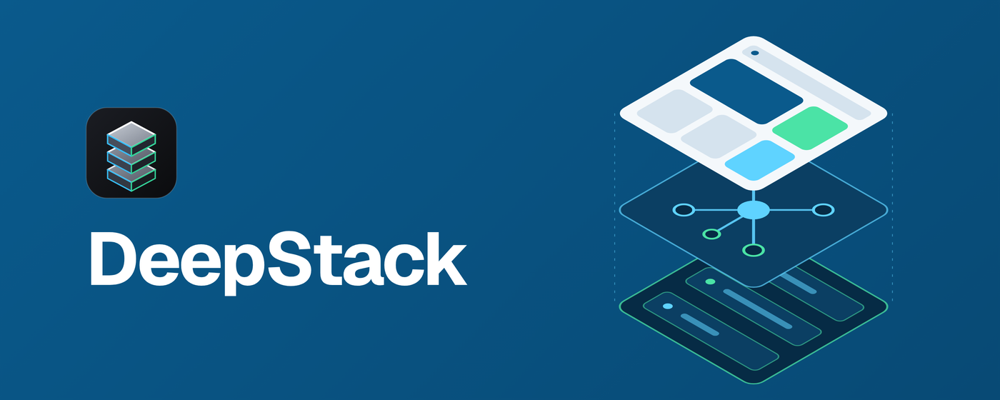
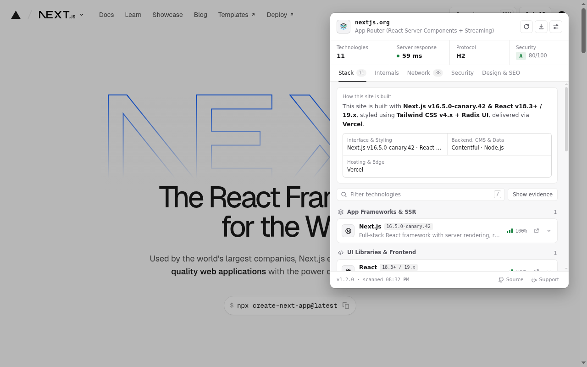
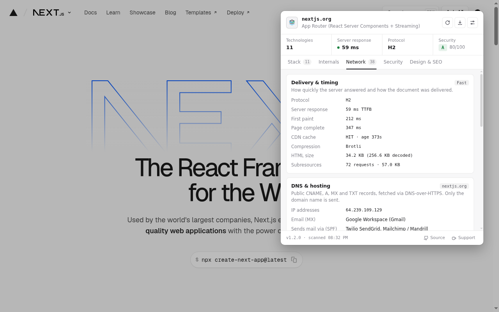
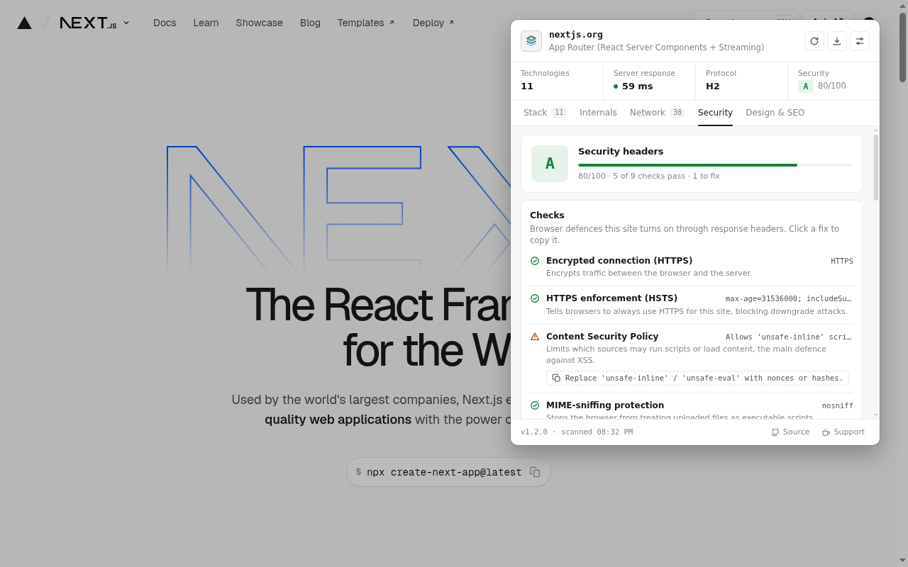
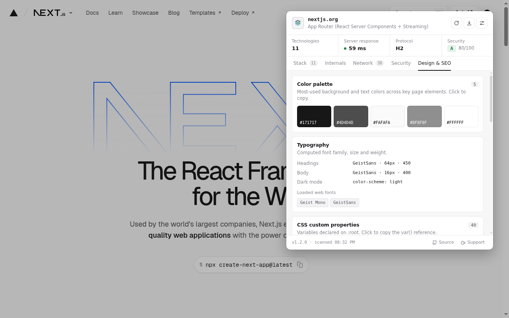

<p align="center">
  
</p>

<p align="center">
  <a href="LICENSE"></a>
  
  
  
</p>

# DeepStack

DeepStack is a browser extension that shows how the website in your current tab is built: its frameworks, rendering model, hosting, APIs, security headers and design tokens.

Most technology detectors give you a list of logos. DeepStack shows the evidence behind each finding, such as the script URL, response header, DOM marker or global variable it matched, along with a confidence score, so you can check the result yourself rather than take it on trust.

<p align="center">
  
</p>

## Features

DeepStack opens as a toolbar popup with five tabs.

**Stack.** A one-paragraph summary of how the site is built, a map of the interface, backend, hosting and third-party layers, and every detected technology grouped by category. Each entry shows its version (where it can be determined), a confidence score and the evidence it was matched on. There are roughly 200 technology signatures.

**Internals.** The rendering model (server-rendered, static, React Server Components streaming, islands or single-page app). It also shows framework metadata such as router, build ID and current route, the bundler, service workers, IndexedDB databases, Cache Storage and storage key names.

**Network.** Server response time, first paint, protocol, compression and CDN cache status, plus the API endpoints the page calls (REST, GraphQL, tRPC, WebSocket, server-sent events) and the third-party domains it loads from. The Content Security Policy is parsed to list hosts the page is allowed to reach but hasn't contacted yet. Optionally, it shows public DNS records (CNAME, MX, SPF, TXT verification tokens) to identify the hosting and email providers.

**Security.** A letter grade based on HTTPS, HSTS, Content Security Policy, MIME sniffing, clickjacking protection, referrer, permissions and cross-origin policies, plus an audit of cookie flags. Each failing check comes with the header you would send to fix it, ready to copy.

**Design & SEO.** The computed colour palette, typography, loaded web fonts, `:root` CSS custom properties, Open Graph tags, canonical URL and JSON-LD schema types.

Reports can be exported as Markdown or JSON, and any value can be copied with a click.

<table>
  <tr>
    <td></td>
    <td></td>
    <td></td>
  </tr>
  <tr>
    <td align="center">Network</td>
    <td align="center">Security</td>
    <td align="center">Design &amp; SEO</td>
  </tr>
</table>

### Keyboard shortcuts

| Key | Action |
| :-- | :-- |
| <kbd>1</kbd>–<kbd>5</kbd> | Switch tab |
| <kbd>/</kbd> or <kbd>Ctrl</kbd>/<kbd>⌘</kbd> + <kbd>K</kbd> | Filter technologies |
| <kbd>E</kbd> | Expand or collapse all evidence |
| <kbd>R</kbd> | Rescan the page |
| <kbd>C</kbd> | Copy the report as Markdown |
| <kbd>Esc</kbd> | Clear the filter or close a menu |

## Installation

DeepStack runs in any Chromium-based browser from version 111 onwards.

To install from source:

1. Clone the repository, or download it as a ZIP and extract it.
   ```bash
   git clone https://github.com/EmmanouelKontos/deepstack.git
   ```
2. Open `chrome://extensions` (or `brave://extensions`, `edge://extensions`).
3. Enable **Developer mode**.
4. Click **Load unpacked** and select the repository folder.

Pin the extension to the toolbar, open any website and click the DeepStack icon.

## Privacy

DeepStack has no servers, no analytics and no accounts. All analysis happens in your browser.

- Cookie values, `localStorage` / `sessionStorage` values and form contents are never read. Only cookie names and their security flags are inspected.
- `Set-Cookie` headers are reduced to cookie names before anything is stored or displayed.
- Captured headers are kept in session storage for the life of the tab and discarded when it closes.

The extension makes network requests only when you open the popup, and only in two cases:

- **DNS lookup (opt-in, off by default).** The domain name is sent to Cloudflare's DNS-over-HTTPS resolver to read public DNS records. No paths, query strings or cookies are included.
- **Header fallback.** If the tab was opened before the extension was running, one cookie-less `HEAD` request is sent to the page's own URL to read its response headers.

The full policy is in [PRIVACY.md](PRIVACY.md).

### Permissions

| Permission | Why it is needed |
| :-- | :-- |
| `activeTab`, `scripting` | Run the read-only inspection scripts on the page you are viewing. |
| `webRequest` | Read response headers and request URLs. Requests are never blocked or modified. |
| `cookies` | Read cookie names and flags, including `HttpOnly` cookies that page scripts cannot see. Values are never read. |
| `storage` | Save your preferences and hold per-tab header data for the current session. |
| `http://*/*`, `https://*/*` | Inspect whichever site you open the popup on. |

## How it works

```
 page ──► main-world-probe.js ──┐                       ┌──► popup (panels, export)
         (framework globals,    ├──► service worker ────┤
          perf, storage keys)   │    (headers, cookies, └──► toolbar badge
 page ──► isolated-collector.js ┘     analysis engine)
         (DOM, scripts, meta,
          CSS tokens, palette)
```

- Two content scripts gather signals from the page. One runs in the page's own JavaScript context to read framework globals; the other runs in the extension's isolated context to read the DOM, scripts, metadata and computed styles.
- The service worker records response headers and request URLs per tab through `webRequest`. It keeps them in `chrome.storage.session` so nothing is lost when the worker is suspended, and it handles pages that are prerendered before you visit them.
- The analysis engine (`src/engine`) matches all of that against the signature database and attaches evidence to each detection. It then derives versions, the rendering model, API endpoints and the security grade.

There are no runtime dependencies and no build step for development. The extension is plain ES modules.

## Development

Load the folder unpacked as described above. After editing, reload DeepStack on the extensions page and reopen the popup.

To produce the package uploaded to the Chrome Web Store:

```bash
./scripts/build.sh
```

The script syntax-checks every source file and writes `dist/deepstack-v<version>.zip` containing only the manifest, icons and `src/`.

```
src/
├── background/   service worker and per-tab header store
├── content/      page probes (main world and isolated world)
├── engine/       signature database, matching, network, security, DNS
├── popup/        popup shell, panels, styles and UI helpers
└── shared/       settings shared by the popup and service worker
store/            Chrome Web Store listing copy
scripts/          build script
```

### Adding a technology signature

Signatures live in [`src/engine/signatures.js`](src/engine/signatures.js). Each entry defines the patterns that identify a technology: script URLs, globals, DOM markers, headers, cookies or meta tags. It can also define how to read its version. Please include a public site that uses the technology when you open a pull request, so the signature can be checked against a real page.

## Contributing

Bug reports and pull requests are welcome. If DeepStack misidentifies a site, open an issue with the URL, what it reported and what the site actually uses.

## Support

DeepStack is free and open source. If you find it useful, you can [buy me a coffee](https://buymeacoffee.com/emmanouilkontos).

## License

Released under the [MIT License](LICENSE).

Built by [Emmanouil Kontos](https://emmanouilkontos.com).
